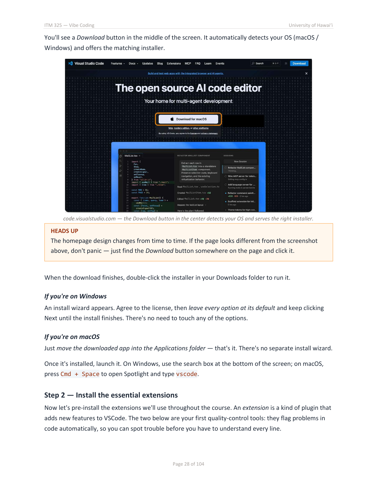
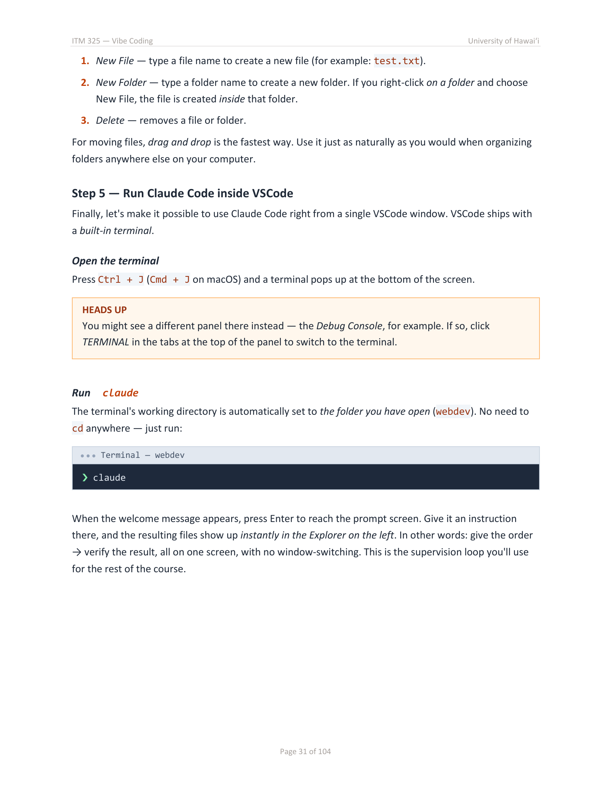

# Windows Setup

[Back to computer selection](README.md)

Follow these three steps in order. You will finish with Claude Code responding inside VS Code. Prepare your course Claude account first using **guidebook pages 12 to 14**.

## Step 1 Install VS Code

**Guidebook pages 27 to 28.**

1. Open the [official VS Code download page](https://code.visualstudio.com/download).
2. Choose the Windows **User Installer** for your computer. Most PCs use x64. A Windows ARM PC needs Arm64. If you are unsure, open Windows **Settings > System > About** and look at **System type**.
3. Open the downloaded installer and complete the installation. Use the standard location. Keep **Add to PATH** selected if that option appears. You do not need GitHub Copilot for this lesson; if the installer offers the Copilot command, choose **Don't add the copilot command**.
4. Open **Visual Studio Code**. You may skip optional account sign-in, customization, and extension suggestions.

**Check before moving on:** VS Code opens to its editor or welcome screen. This is Visual Studio Code, not Visual Studio.

<details>
<summary>See the guidebook installation page</summary>



The current installer may show extra optional features. Follow the instructions above when a screen differs.

</details>

## Step 2 Set up the course tools

**Guidebook pages 14 to 20 and 23.** The helper handles the installation and command-location steps in those pages.

1. Open the Windows Start menu. Search for **Windows PowerShell** and open it normally. Choose the entry **without x86**. Do not choose **Run as administrator**.
2. Copy the entire command below, paste it into PowerShell, and press **Enter**.

```powershell
& ([scriptblock]::Create((Invoke-RestMethod -Uri 'https://raw.githubusercontent.com/cyj-oss/itm325-setup/main/setup-windows.ps1')))
```

3. Read the setup summary. Type **Y** and press Enter to continue. The helper will install missing tools and show its progress. If Windows or the installer asks for permission or an agreement, read it and continue only if you agree. If you are not allowed to approve installation, stop and contact your instructor or IT support.

The helper installs Git when needed, keeps working installations, prepares missing command locations, and checks Claude Code. It leaves existing Git settings in place. Your Git name and email can be set when you begin the Git lesson; they are not needed for today's Claude response check.

**Wait for this exact result:**

```text
READY FOR STEP 3
```

The helper also prints **Course folder:** followed by the full folder location. Keep that location for Step 3. It reuses `C:\webdev` if that folder already exists. Otherwise, it creates `webdev` inside your Windows user folder, outside the usual OneDrive Documents and Desktop folders.

If you see **SETUP STOPPED**, do not continue yet. Read the short reason and use [Troubleshooting](TROUBLESHOOTING.md). After fixing the issue, you can run the same command again; the helper checks existing installations first. If Git needs a restart, restart before rerunning.

## Step 3 Connect and test

**Guidebook pages 23 to 24 and 30 to 31.**

1. Save your work. Close **all VS Code windows** and the PowerShell window. Open VS Code again so it sees the new command locations.
2. Choose **File > Open Folder**. Open the exact course folder printed by the helper. If VS Code asks about trusting the folder, confirm only after checking that it is your own course folder.
3. Choose **Terminal > New Terminal**. The terminal should be **PowerShell**. If another terminal appears, use the dropdown beside the plus button to open PowerShell.
4. Run this command in that terminal.

```powershell
claude --version
```

**Check:** A version number followed by **Claude Code** appears. Your number may differ from the guidebook. If the command is not recognized, stop and use [Troubleshooting](TROUBLESHOOTING.md).

5. Start Claude Code.

```powershell
claude
```

6. Follow the first-run prompts. If asked, select the option for a **Claude account with a subscription**, then sign in through the browser using your course account. Return to VS Code when sign-in finishes. Review any folder-access prompt and confirm only for your course folder. The order and wording of these screens may change.
7. In **Claude's message area**, send this message.

```text
Please reply with Ready for ITM 325. Do not create, edit, or delete any files. Do not run any commands.
```

**You are done when:** VS Code is open, your course folder is open, Claude is signed in, and Claude replies to your message. The reply may contain extra words. A version number alone does not confirm account access.

To exit Claude, press **Ctrl+C twice**. Run ordinary terminal commands after leaving Claude, not in its message area.

<details>
<summary>See the guidebook page for using Claude inside VS Code</summary>



</details>

[Need help?](TROUBLESHOOTING.md) · [Back to start](README.md)
